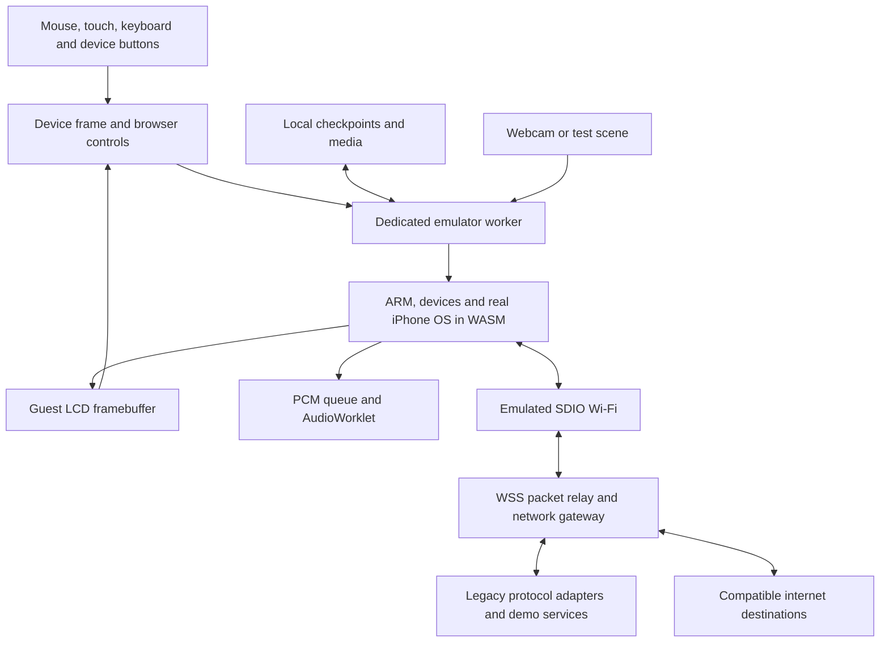
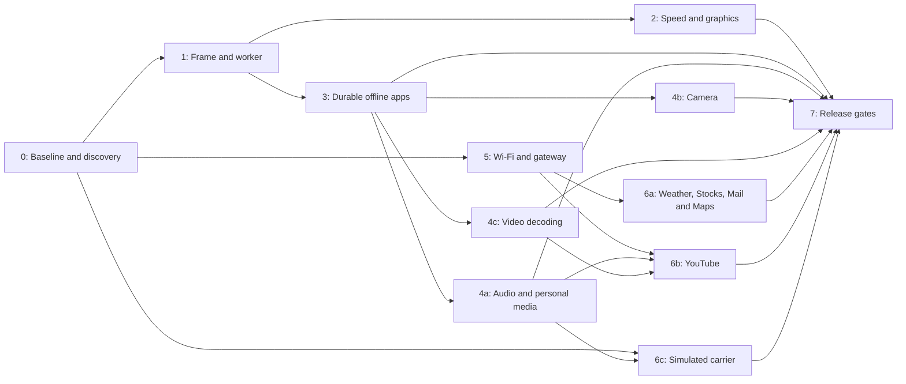

# Delivery plan: a usable original iPhone in the browser

> Historical recordings and publishing artifacts have been removed from Git history. The summaries below describe the original runs; remaining test reports and screenshots are retained. Historical hash receipts may predate this archival cleanup.

Planning baseline: 2026-09-05, local commit `b0a7399`. This is a proposed implementation plan, not a claim that the features below are complete. The existing browser recordings demonstrate SpringBoard, Settings, Safari launches, and Home navigation; the other app workflows need verification.

## Current execution priorities — 2026-09-06

The physical web phone, all16 app launches, several persistent organizer workflows,
RTC updates and compiled-seed reuse are implemented. The full product gates below
are still open. [The project overview](README.md) links current evidence.

1. Prioritize a measurable improvement in actual app-launch responsiveness. Warm
   Settings remains around3–3.6 seconds in recorded cloud Chrome tests, above the
   two-second target. The next targeted warm Settings/Home measurement is pending;
   the completed100M instruction census is diagnostic evidence, not a speedup.
2. The bounded Safari source-row correction is integrated in the default local
   package after saved-phone upgrade/offline checks; see [096](https://github.com/kelindi/iphone-1/blob/09c68979f3df9f4e80b00c66cb4e2e8676e350fd/docs/traces/mbx-stride-release/README.md).
   Photos navigation and the default Safari demo service remain unaccepted. A
   follow-up Photos attempt has no completed acceptance result.
3. Defer further audio/network research while resolving speed. Close out existing
   diagnostic evidence without interpreting incomplete runs as app acceptance.
4. Use [the completion checklist](completion-checklist.md) to distinguish useful
   workflows from app launches, and integrated changes from isolated experiments.

## Product destination

Open a URL and see an original iPhone: silver rim, black glass, earpiece, a real 320×480 guest display, and clickable Home, sleep/wake, volume, and ringer controls. Unlock it, type on its keyboard, swipe lists, open every original app, play music, take a picture, browse compatible sites, and keep your data when you return.

Apple's genuine iPhone OS 1.0 remains responsible for every app and the phone's screen. CSS/SVG supplies the physical case and surrounding browser controls. We emulate hardware and provide compatible external services; existing device-tree, activation-data, and filesystem workarounds are explicitly tracked. No Apple executable patches are planned.

Default first-release target: Chrome and Safari on modern desktop/laptop hardware, with responsive page layout and mobile-browser support as a later acceptance tier. Record exact machines and browser versions during baseline testing. This is a planning assumption pending the user's browser preference.

The emulator runs locally in WebAssembly. A separate service handles network transport and legacy app protocols. First release includes deterministic demo data for network-dependent apps, with live data where a provider and compatible protocol are proven. Remote streaming is a contingency to evaluate only if local execution cannot meet performance gates; it is not the default architecture.

## What “full speed and functionality within reason” means

These are proposed release gates, to be measured on the agreed reference laptops; they are not current results.

| Experience | Acceptance target |
|---|---|
| Start using the phone | Cached visit reaches an interactive saved state within 5 seconds. First visit exposes real download progress and retries; set its budget after measuring asset transfer, decompression, compilation, and peak memory. |
| Button and touch response | 95th-percentile input-to-visible-guest-feedback ≤150 ms over at least 30 samples per representative interaction. OS actions triggered on release are measured from release; intentional long-press duration is excluded. |
| App navigation | Home → ready-to-use local app and app → usable Home ≤2 seconds at the 95th percentile over 20 warm runs. Measure first launch separately, target ≤3 seconds. Network fetch time is reported separately. |
| Animation | 30+ distinct guest frames/second during supported animated sequences, aiming for 60 where the guest produces them. Repainting the same framebuffer does not count. No unexplained black app-close interval. |
| Time and sound | Foreground Stopwatch stays within 2% of wall time over 60 seconds under idle and representative mixed load. Ten-minute music playback has no sustained underruns or accumulating drift. |
| Saved state | Notes, events, contacts, settings, and media survive refresh, tab close, and export/import. Interrupted saves preserve the last complete checkpoint. |
| Stability | A 30-minute mixed-app session completes without guest panic, browser crash, stuck input, or unbounded memory growth. |
| Coverage | Each of the 16 apps passes its workflow below. Opening an app alone is insufficient. Unsupported external capabilities are described in the surrounding help. |

“Full speed” is comparable interactive behavior to the original phone, not modern-phone capabilities or a guaranteed 412 million emulated instructions/second. Keep the guest clock model honest. Raising CPI, hiding a transition, or using a snapshot does not prove that guest execution is faster. When original-device timing is available, preserve natural behavior and report that reference alongside these provisional budgets.

## All 16 original apps: intended release behavior

All rows below remain release targets. Current accepted workflows and failures are tracked in [the app audit](app-coverage.md) and [execution log](execution.md); the initial planning baseline above is historical.

| App | Workflow that must work | Dependencies and practical boundary |
|---|---|---|
| Text | Open a seeded conversation, send a message to a demo contact, receive a scripted reply, delete it, and retain history. | Minimal simulated baseband/SIM/SMS behavior consumed by genuine CommCenter. Real carrier SMS is outside the initial target. |
| Calendar | Create, edit, and delete an event; browse dates; fire an alert while the emulator is running. | Writable guest data, clock, persistence, and audio. External calendar sync is optional. |
| Photos | Browse imported/demo albums, swipe, pinch zoom, rotate between portrait/landscape, and use supported slideshow controls. | Original Camera Roll now discovers guest-created DCF JPEG/THM pairs; synced albums still need their database. Populated navigation currently fails rendering. Graphics, multi-contact input, and accelerometer remain dependencies. |
| Camera | Preview a webcam or deterministic test scene, take a photo inside Camera, and see it in Photos after reload. | Camera sensor/controller emulation and guest media integration. Webcam capture alone does not make Camera work. |
| YouTube | Browse/search a curated catalog and play a permitted, compatible-format clip with sound in the original app. | Reverse-engineered service responses and guest video decode/rendering. Arbitrary current YouTube accounts, DRM, and full catalog parity are outside the initial target. |
| Stocks | Add/remove a supported symbol, view quote and chart, retain the list. | Compatible service with a fixed demo dataset first; optional live provider with source/time labels. |
| Maps | Pan/zoom a map, search a supported place, and display a route for the supported demo area. | Legacy map/search/directions protocol adapter with supplied tiles and route data. General live coverage follows provider/protocol validation. |
| Weather | Add/remove supported cities, view forecast, and retain city choices. | Fixed demo forecast followed by a live adapter if viable. Never present demo data as current. |
| Clock | Use world clocks, stopwatch, timer, and an audible foreground alarm. | Correct guest time and sound. Scheduled alarms while the host browser is closed are outside the initial target. |
| Calculator | Enter, correct, and evaluate representative calculations using the original keypad. | Input/CPU/render correctness; an early independent acceptance case. |
| Notes | Create, edit, and delete notes with the guest keyboard; preserve them across reloads. | Guest filesystem durability and text input. |
| Settings | Change brightness, wallpaper, sounds, date/time, and supported preferences; join the simulated Wi-Fi AP. | Verify actual effects in guest behavior and persistence. Hardware that is not modeled is disclosed. |
| Phone | Manage contacts/favorites, dial a demo number, receive/answer/end a simulated call, hear demo audio, and retain recents. | Simulated carrier and audio. Contacts live within Phone in this OS. Real telephone service and carrier voicemail are outside the initial target. |
| Mail | Read, send, reply, and delete using a private demo mailbox; retain account state. | Guest-compatible IMAP/POP/SMTP service. External accounts need a separate modern-auth adapter and are optional. |
| Safari | Enter URLs, follow links, scroll, zoom, rotate between portrait/landscape, navigate back/forward, manage bookmarks, and load a defined set of compatible pages. | Guest Wi-Fi, network relay, and accelerometer. Modern TLS and retired protocols may need a compatibility gateway; modern JavaScript-heavy web apps are not a release promise. |
| iPod | Browse demo/imported music, play/pause/seek, change volume, rotate into Cover Flow, browse artwork, and play one supported video. | M68 audio codec/I2S/DMA, accelerometer, guest media databases and video pipeline. Use supported DRM-free formats; modern streaming services are outside the initial target. |

A demo service still exercises the real app, real guest networking, and real protocol handling. If an app requires an unmodeled hardware path or cannot accept a compatible response without binary changes, report the failed gate and revisit scope; do not replace its screen with a web imitation.

## Architecture and browser constraints

Move CPU execution out of `requestAnimationFrame` in `web/app.js`. Start with one dedicated worker owning the entire machine and transferable framebuffer buffers; keep command slices bounded so it receives input promptly. Use a small recycled buffer pool and drop obsolete presentation frames instead of queuing latency. Worker scheduling frees the browser UI but does not by itself accelerate guest execution.

Add shared memory only if profiling justifies it. Emscripten pthread builds require COOP/COEP headers and separate threaded/non-threaded artifacts for fallback. A single worker does not inherently require pthreads or shared memory. Any deployment using those features must serve the required headers. [Emscripten pthread guidance](https://emscripten.org/docs/porting/pthreads.html)

Keep network sockets outside `core/`: emulated guest Ethernet frames cross a WSS connection to an isolated gateway running a maintained userspace network stack. Emscripten's POSIX socket proxy cannot automatically intercept sockets inside emulated XNU. Browsers do not expose arbitrary TCP sockets, so a static frontend alone cannot supply the intended guest internet connection. [Emscripten networking](https://emscripten.org/docs/porting/networking.html)

Use Cache Storage for versioned immutable assets and IndexedDB initially for transactional checkpoint metadata/chunks; evaluate OPFS for large persistent images. Check quota, request persistent storage where available, and provide downloadable backups because browser storage can be evicted. [Browser storage behavior](https://developer.mozilla.org/en-US/docs/Web/API/Storage_API/Storage_quotas_and_eviction_criteria)

Send guest PCM to an AudioWorklet with a bounded queue, sample-rate conversion, and underrun counters. Start audio after an explicit user gesture. Offer webcam input only on user request, with a test scene fallback if permission is denied. These APIs supply host output/input; guest audio and camera devices still need implementation. [AudioWorklet](https://developer.mozilla.org/en-US/docs/Web/API/AudioWorklet), [getUserMedia](https://developer.mozilla.org/en-US/docs/Web/API/MediaDevices/getUserMedia)

## Delivery sequence

### 0. Establish a reproducible baseline and expose the hard unknowns

- Install and pin native/Emscripten toolchains, run all 22 native test executables and the WASM smoke test, then reproduce the browser recording from this checkout.
- Add real browser automation: load snapshot, dismiss alert, open Settings, Home, open Safari, Home, and save video plus serial/console logs. The existing `web/smoke.mjs` only checks initialization error handling.
- Inventory all 16 apps with launch result, first blocked action, guest crash/log evidence, required hardware, and screenshot. Capture protocols for service-dependent apps as connectivity becomes available.
- Measure app latency, ARM/Thumb/VFP execution hotspots, unique frame cadence, cold/warm startup phases, audio status, and peak resident memory on reference hardware. Baselines in the old log are historical, not current benchmarks.
- Probe speed feasibility, baseband startup, Camera driver dependencies, and a representative old service protocol early. Do not leave those discovery tasks until the final integration milestone.
- Include accelerometer/rotation discovery: Safari and Photos landscape plus iPod Cover Flow depend on it. These behaviors are part of the original product, as described in [Apple's introduction](https://www.apple.com/newsroom/2007/01/09Apple-Reinvents-the-Phone-with-iPhone/). No corresponding sensor implementation was identified in this checkout.
- Fix known onboarding inaccuracies: input availability, firmware assets, `web/manifest.json`, `web/dist/emu.*`, and obsolete PR branch instructions. Target new work at `main`.

Deliverable: an app inventory and repeatable benchmark/report bundle. Exit gate: independent reproduction of existing navigation and an evidence-backed backlog for every app.

### 1. Make it look and handle like an iPhone

- Build the physical case with CSS/SVG around the existing guest canvas; preserve guest pixels and proportions. Include earpiece, bezel, Home recess, top sleep/wake button, volume rocker, and a stateful ringer switch.
- Put real button elements over physical controls, with accessible names, keyboard focus, generous hit areas, and pressed feedback. Wire press/release and long holds to existing guest GPIO input; release on pointer cancellation, lost capture, blur, or worker failure. The ringer is a toggle, not a momentary press.
- Preserve swipe/drag and double-tap. Extend the browser API to deliver multiple contacts for pinch zoom; provide an optional desktop two-finger gesture mode. Prevent browser scrolling/zoom only over the phone's interactive surface.
- Audit Z1 contact lifetimes before claiming gestures work: `mtz1.c` currently rejects submissions with a pending frame and rewrites accepted phases to MAKE_TOUCH, while the JS frontend ignores touch API errors. Coalesce move samples, preserve and acknowledge ordered down/up events, retry backpressure safely, and test stable contact IDs and phases through drag/pinch/release.
- Add a Rotate control that changes an emulated accelerometer input and rotates the physical case with matching coordinate transforms. Verify the guest actually changes layout; rotating the canvas alone does not satisfy landscape or Cover Flow. Schedule sensor completion with the graphics/media work if it exceeds the initial shell slice.
- Keep the original on-screen keyboard fully usable. Treat host-keyboard typing as a later convenience that must travel through a verified guest input path.
- Introduce the worker transport, a small loading/retry experience, and secondary controls for reset, import/export, sound, and help. Move serial/instruction counters into an optional developer panel.

Primary files: `web/index.html`, `web/app.js`, `web/emu_api.c`, new shell styles/SVG and worker module.

Exit gate: a recorded phone-shaped demo with functioning Home, lock/unlock, volume/ringer, swipes, and no stuck input after focus loss. This is an early preview; app completeness and speed are still separate gates.

### 2. Reach interactive speed and complete visible rendering

- Profile after the worker change. Audit existing fetch, data-read, and opt-in data-write caches before implementing the older speed plan; several primitives already exist in `arm.h`.
- Give clock pacing its own task: audit `s5l8900_set_active_host_clock` and `s5l8900_set_wfi_host_pacing`, which exist in the core but are not wired into the web API. Define foreground pacing, idle/WFI advance, overload, and pause/resume rules before choosing a host-clock mode. Preserve deterministic execution for regression comparisons and measure clock drift separately from instruction throughput.
- Audit M68 date/time separately from monotonic time. [Original OS 1.0 source-byte inspection](https://github.com/kelindi/iphone-1/blob/09c68979f3df9f4e80b00c66cb4e2e8676e350fd/docs/traces/rtc-write-contract/README.md) confirms an implemented asynchronous seven-byte RTC setter; the inherited panic-stub comment does not describe this driver. The emulator still ignores RTC writes. Capture a genuine date-change transaction, define partial-write/rollover behavior and verify manual settings and persistence before establishing host synchronization. Include a fixed-date deterministic test mode, timezone and restore/resume policy. Calendar alarms, Mail dates, and TLS validation must see coherent time without altering instruction accounting.
- Implement/reuse a portable decoded-block executor and optimize hot ARM/Thumb paths, memory access, timer dispatch, and framebuffer conversion based on measurements. Preserve the interpreter as the correctness reference.
- The inherited optional AArch64 static engine was removed on 2026-10-14 because its generator was never in the repository; it never ran in the browser.
- Fix the OS 1.0 MBX commands responsible for black transitions and missing app content. Start from guest packet traces and a correct CPU rendering path; add WebGL/WebGPU acceleration only if measurements justify it, with a portable fallback.
- The old 2.5× native speed goal is an intermediate checkpoint, not a guarantee of real-time browser behavior. Re-run all product performance gates after each substantive improvement.
- If decoding/caching is insufficient, prototype hot ARM/Thumb blocks translated into WebAssembly modules. Retain shared guest state, checked memory/device helpers, exact exception/interrupt boundaries, and interpreter fallback. Compile bounded hot regions asynchronously, cap cache growth, and measure compilation warm-up and inter-module overhead. Browsers can compile WASM modules at runtime; whether this yields enough speed here is an engineering hypothesis. [WebAssembly compilation API](https://developer.mozilla.org/en-US/docs/WebAssembly/Reference/JavaScript_interface/compile_static)
- Differential coverage must include self-modifying code, MMU aliases/permissions, TLB changes, ARM/Thumb transitions, VFP, MMIO, exceptions, WFI, interrupts, and snapshot restore. Compare architectural state and device outcomes, then cold-boot and run app workflows.

Exit gate: measured latency, animation, and time targets pass on reference browsers. If they fail after the translator experiment, report the actual bottleneck and choose a revised device floor, deeper engine work, or a separately approved remote-emulation design. Do not promise all-app full speed before this gate. Remote execution still needs its own CPU and round-trip latency proof.

### 3. Make the offline phone useful and durable

- Verify Calculator, Notes, Calendar, Clock, Settings, and Phone's contact management. Fix their concrete guest failures rather than assuming successful launch implies usability.
- Expose `snapshot_save_mem` through a safe worker checkpoint API. Snapshot CPU, RAM, devices, and the ramdisk together at an instruction boundary. Commit immutable chunks and a checksum/version manifest atomically; retain the previous valid generation. Prevent two tabs from writing the same profile concurrently.
- Autosave periodically and on visibility changes without relying on unload completing. Provide explicit save, export/import, reset, and recovery from a corrupted/incompatible checkpoint. Set and publish a measured maximum unsaved interval; initial target ≤30 seconds while foregrounded.
- Preserve saves across runtime upgrades: the current snapshot loader requires an exact format match (`SNAPSHOT_VERSION=39`). Keep the compatible runtime/assets available for old profiles until a tested migration or guest-data export/import path exists. Never silently reset a profile because a new device model changed its snapshot schema.
- Persisting the current ramdisk snapshot is a valid first durable implementation. Profile its cost before adopting dirty-page deltas; any delta design must capture CPU, DMA, GPU, and all other memory writers.
- Include autosave in input-latency and audio-continuity acceptance. `snapshot_save_mem` synchronously scans/serializes the machine and allocates a full output buffer, so worker placement alone does not eliminate guest pauses. Measure capture/compression/commit separately, then introduce bounded capture or an equivalent consistent-state strategy if required.
- Restoring a checkpoint discards stale host audio/input queues and reconnects the network backend. Guest TCP sessions and a remote server's state cannot be restored by a local memory snapshot; define network reset/reconnection behavior and verify recovery in Safari and Mail.
- Keep hardware NAND/disk0 fidelity separate unless an app needs it. If required, add guest block storage with durable backing and re-run cold boot using the real partition layout. Do not spend weeks on NAND merely to save a note.
- Produce a versioned base image with working preferences and sample contacts/photos/music. Import media using a supported guest service when possible; offline database/image edits require a cleanly stopped guest and a cold boot into the updated image. Editing a mounted image, even with the CPU paused, can conflict with guest filesystem caches.
- After baseband behavior is understood, generate a clean initial state without a recurring Repair Needed interruption. A pre-dismissed snapshot is acceptable for previews; it is not evidence of a baseband fix.

Exit gate: edit a note/event/contact, change settings, reload, recover the same data, export/reset/import, and recover again. Offline workflows and forced-interruption tests pass.

### 4. Add sound, personal media, and Camera

- Model the M68 WM8758 codec and required I2S/DMA behavior. The current I2S implementation stores registers; the N82 WM8991 model is not proof that original-iPhone audio works.
- Implement sample-clock-paced peripheral/DMA transfers or a measured equivalent, including FIFO demand and completion interrupt cadence. The existing PL080 implementation completes transfers by the next retired instruction, so attaching an AudioWorklet alone cannot establish correct guest audio timing. Test sample counts, interrupt cadence, and audio/video synchronization.
- Connect PCM to the browser audio path. Verify mute/volume, sleep/wake, alarms, iPod music and video, channel layout, timing, and underflow recovery.
- Import supported photos/music and construct their actual OS 1.0 libraries, artwork, and thumbnails. Ensure Photos gestures and iPod playback operate on this data.
- Reverse-engineer the actual Camera driver, attach its sensor/controller and buffers, feed a deterministic scene, and get a photo into the guest camera roll. Then add optional webcam capture converted to the expected dimensions/format.
- Trace any video decoder or graphics hardware dependencies that prevent playback; host video playback over the guest display does not meet the real-app target.
- Complete accelerometer-driven portrait/landscape behavior in Photos and Safari and Cover Flow in iPod. Include guest-generated rotation animations in the graphics and performance tests; synthetic sensor samples are sufficient, with optional host orientation integration later.

Exit gate: a recording captures music playback and controls, a saved Camera photo opened in Photos, zoom/slideshow, and one iPod video. Audio/performance/persistence gates remain green. Camera and video decoding are high-uncertainty work, so milestone 0 discovery determines their detailed task breakdown.

Implement and accept audio/music, Camera, and video decoding as separate work packages. Successful music/Photos support can ship in a preview while Camera or video research continues; the complete app matrix still requires all three.

### 5. Connect the guest to a controlled network

- Extend `plans/wifi.md`: SDIO enumeration → firmware handshake → simulated open AP → association → `en0` → DHCP/DNS → guest HTTP request. Verify from cold boot; regenerate snapshots with the device present.
- Implement `net_tx`/`net_rx` host callbacks and a browser WSS packet relay with bounded queues and reconnection. Use a maintained userspace stack such as libslirp on the gateway instead of writing a new TCP stack.
- Isolate each phone's network state. Restrict gateway destinations to the intended public/demo endpoints, block private/link-local/metadata destinations after DNS resolution, and bound connection/resource use. This is necessary for operating a public relay safely.
- First prove a controlled page served in a format old Safari supports. Add a gateway for selected current content only after that works. TLS compatibility and 2007 HTML/CSS/JavaScript compatibility are separate problems: decrypting HTTPS does not upgrade WebKit.
- For legacy HTTPS, test the guest's supported handshake/ciphers and trust validation. If required, use an explicitly configured compatibility authority in the work image for project services, with modern TLS upstream. Do not assume DNS rewriting alone defeats certificate checks.

Exit gate: join the AP in genuine Settings, browse the controlled test site in Safari, follow links, submit a form, bookmark it, reconnect, and preserve browsing state. Gateway outage must not hang the emulator. The old plan's no-op browser network backend is insufficient for this product.

### 6. Complete online apps and the simulated carrier

- Record actual guest requests and implement one protocol adapter at a time: Weather and Stocks, demo Mail, Maps, then YouTube. Store protocol fixtures and deterministic integration tests. Validate response formats and TLS/auth constraints before choosing live providers.
- Supply reproducible demo datasets as the acceptance baseline. Add live data separately with attribution and timestamps; include provider quotas, keys, media conversion, and operating cost in the deployment configuration.
- Implement the minimum baseband/SIM protocol needed by genuine CommCenter, Phone, and Text: readiness, registration, call state, SMS delivery, and audio routing. Drive demo incoming calls/messages from a surrounding “Demo events” control. A fake status-bar signal indicator does not satisfy this requirement.
- Treat actual public telephone calls/SMS, arbitrary external email authentication, general modern YouTube, and unrestricted modern-web compatibility as later products.
- Fix USB ordering if it blocks stable daemon operation, import/sync, or clean guest behavior. Otherwise the existing unmatched USB workaround can remain in the browser release with documentation. Full USB enumeration and the complete boot ROM chain are not prerequisites for this experience.

Exit gate: each app table row passes through the genuine UI, with a short recording and reproducible fixture. Simulated call and message flows work without repeated baseband alerts. Unknown protocols remain explicit blockers, not “done” labels.

Weather/Stocks/Mail/Maps adapters depend on milestone 5, not Camera. YouTube depends on networking plus audio/video. Simulated calls depend on baseband and audio; SMS/baseband discovery can advance independently. Keep those gates separate so one unmodeled device does not stall unrelated useful apps.

### 7. Ship and keep it working

- Publish a reproducible HTTPS frontend/asset build plus a separately deployable relay/service backend. Select hosting based on WSS duration, required headers, storage, and bandwidth; verify those capabilities before migration. Static Pages alone does not run the gateway.
- Version the emulator, firmware/work-image manifest, snapshot schema, service fixtures, and cache keys together. Verify hashes before loading assets. Measure and reduce startup memory copies; the current JS path holds compressed, decompressed, and WASM copies of large images.
- Planning-baseline home snapshot parts totaled 99,236,836 bytes (94.6 MiB); the gzip trailer reports 244,441,246 uncompressed bytes (233.1 MiB, modulo 4 GiB). At 100 Mbit/s the snapshot transfer alone has a theoretical floor of about 8 seconds, excluding other assets and startup. Validate the full stream and actual peak memory in milestone 0. Keep the 5-second target explicitly for cached startup, and measure checkpoint serialization pauses as well as save durability.
- Test cached offline startup, missing/corrupt downloads, denied storage/camera permissions, audio unlock, background/resume, low quota, two tabs, service outage, and old saves after upgrade. Foreground resume must not produce runaway clock catch-up or stuck audio/input.
- Run native regressions, WASM startup, real browser app flows, release cold boot, snapshot compatibility, and the 30-minute soak. Use a browser automation runner for repeatability and actual Safari testing for the Safari claim; a generic WebKit runner is supplementary.
- Put every app's demo/live/unsupported boundaries in compact surrounding help. Keep the main view focused on the phone.
- Keep release recordings and matching verification reports in `.context/`; do not commit generated media.

Exit gate: all agreed app workflows, browser performance budgets, persistence/recovery checks, and hosted smoke checks pass, with a release manifest and rollback path.

## Priority, dependencies, and delivery decisions

The first implementation slice should be **baseline automation → worker and clickable frame → browser speed proof → saved offline apps**. It yields a useful preview while answering the largest feasibility question early.

Frame/controls and checkpoint plumbing are comparatively bounded. Near-real-time WASM execution, M68 camera/video/audio behavior, baseband protocols, and legacy services contain substantial research uncertainty. Complete milestone 0 and the speed prototype before committing to calendar estimates for the full experience. Release previews incrementally, but reserve “all apps usable” for the full app matrix.

This plan sets product priorities above the older task plans: `speed.md` becomes browser-gated, `wifi.md` needs a working web relay, USB is scheduled by user-visible impact, and SDL moves off the web product's critical path.

For delegated implementation, isolate bounded work by interface: shell/worker transport, execution engine, persistent state, and device/service models. Agree on input, frame, audio, network, and snapshot interfaces before concurrent edits; one integrator owns `machine.c`, shared headers, snapshot schema, and end-to-end acceptance. Two independent subagent reviews of this roadmap's performance architecture and app/hardware coverage are complete. Their findings are incorporated: Z1 event reliability, pacing/RTC, snapshot migration and pauses, host reconnection after restore, accelerometer/Cover Flow, paced audio DMA, and independent Camera/service delivery gates.

Planning is complete; implementation is active. See [the execution log](execution.md) for verified gates and remaining work. The current compact starting phone with the original USB service has a 100,448,071-byte gzip snapshot expanding to 244,932,578 bytes; baseline transfer figures above are historical. Building and deploying the complete product remains unfinished.
